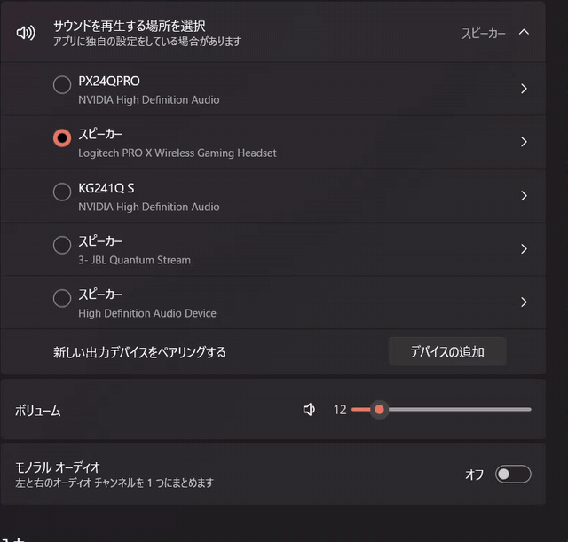

# AudioSwitcher

**Switch your Windows audio output with one hotkey** — no more digging through Sound settings when you swap between speakers, a headset, or a DAC.



A resident audio output switcher for Windows.
Instantly toggle between two pre-registered playback devices (e.g. speakers and headphones) with a single global hotkey.

- Shows a toast notification with the current output device on every switch
- Pick from 3+ devices with a second hotkey (Multi-Device tab)
- Tells apart devices that share the same name (uses Windows Core Audio IDs)
- Supports auto-start on Windows boot
- English / Japanese UI (English by default)
- No external exe required (talks to the Windows Core Audio API directly)

More info and screenshots: [Yuga's Lab](https://cain218.github.io/Yuga-lab/audioswitcher.html)

## Download

Grab the latest `AudioSwitcher.exe` from [Releases](../../releases). No installation needed — just run the exe.

> **Note:** `AudioSwitcher.exe` is not code-signed, so Windows SmartScreen may show a warning the first time you run it. The full source is in this repository if you want to review it (or build it yourself, see below) first.

## Usage

### 1. First launch / setup

Double-click `AudioSwitcher.exe` to open the settings window.

1. On the **A/B Switch** tab, pick the two playback devices you want to switch between under **Device A** / **Device B**
2. Click the **Hotkey** field and press the key combo you want to use (default: `ctrl+alt+a`)
3. Use the test switch button next to the current output to verify it works
4. (Optional) On the **Multi-Device** tab, turn on the device-select overlay to pick from 3+ devices with a second hotkey (default: `ctrl+alt+s`), and tick only the devices you want to appear in that list
5. On the **Settings** tab, turn on **Start on boot** if you want it to launch automatically with Windows, and **Auto-update** if you want to stay on the latest version. You can also switch the display language between English (default) and Japanese here under **Language**
6. **Save & Run** saves your settings and immediately starts running in the background (**Save only** just saves without launching)

Press the **?** button in the top-right corner (or "Show the tutorial again" on the Settings tab) any time to replay the step-by-step tutorial.

### 2. Normal use

While resident, no window is shown. Each time you press the configured hotkey, the default playback device toggles between Device A and Device B, and a toast notification appears in the bottom-right corner.

### 3. Changing settings

Quit the running AudioSwitcher and launch `AudioSwitcher.exe` again to reopen the settings window (any old instance is automatically terminated to prevent duplicates).

### 4. Quitting

End `AudioSwitcher.exe` from Task Manager.

## Config files

These files are created next to the exe:

- `app_config.txt` — Device A/B, hotkey, auto-start, and display language settings
- `error.log` — Error log for troubleshooting

## Building from source

```
pip install -r requirements.txt
pip install pyinstaller
pyinstaller --noconfirm AudioSwitcher.spec
```

This produces `dist/AudioSwitcher.exe`.

## Requirements

- Windows 10 / 11
